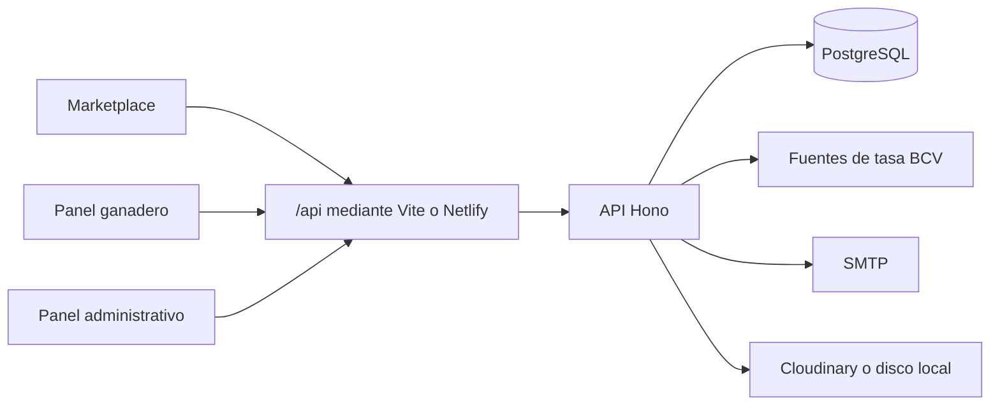
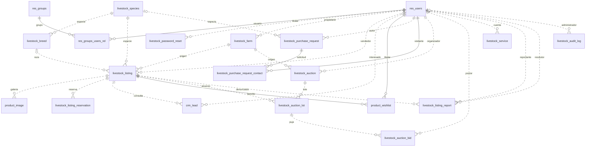

# Documentación técnica de GanadoMarket

**Repositorio de referencia** `marketplace2023/ganado_market` · rama `main` · esquema Drizzle `0004`

GanadoMarket es un marketplace ganadero para Venezuela. El sitio público permite buscar ganado y proveedores, consultar anuncios, contactar vendedores y seguir remates. El panel ganadero concentra fincas, anuncios, consultas, reservas y remates. El panel administrativo verifica fincas, modera contenido y administra usuarios, catálogos y parámetros de operación.

## Índice

- [Alcance funcional](#alcance-funcional)
- [Arquitectura y tecnologías](#arquitectura-y-tecnologías)
- [Flujos y reglas de negocio](#flujos-y-reglas-de-negocio)
- [Modelo de datos](#modelo-de-datos)
- [Relaciones del esquema](#relaciones-del-esquema)
- [Equivalencias con Odoo](#equivalencias-con-odoo)
- [Referencia HTTP](#referencia-http)
- [Ejemplos de integración](#ejemplos-de-integración)
- [Configuración, ejecución y despliegue](#configuración-ejecución-y-despliegue)
- [Actualización de una base existente](#actualización-de-una-base-existente)
- [Límites y diagnóstico](#límites-y-diagnóstico)

## Alcance funcional

| Actor | Puede hacer |
| --- | --- |
| Visitante | Navegar catálogo, fincas, remates, solicitudes vigentes y directorio de servicios. Contactar por WhatsApp o enviar una consulta sobre un anuncio disponible. |
| Comprador | Registrarse, gestionar favoritos y solicitudes de compra, realizar pujas con sesión iniciada y denunciar anuncios. |
| Ganadero | Crear fincas, editar y enviar anuncios a revisión, registrar acuerdos y reservar lotes completos, gestionar consultas, contactar autores de solicitudes activas y preparar remates. |
| Administrador | Moderar anuncios, denuncias, fincas, remates y solicitudes. Administrar cuentas, roles, directorio, especies, razas, tasa de referencia y datos de soporte. Consultar el historial administrativo. |
| Transportista o veterinario | Puede estar vinculado a una ficha del directorio, que se administra desde el panel de administración. |

La venta directa registra el acuerdo y la disponibilidad del lote. Las partes coordinan pago, traslado y entrega por fuera de la plataforma. Los remates registran pujas y muestran el mejor importe por lote. La adjudicación formal, el cobro, la confirmación del comprador, las reservas parciales y la gestión de disputas quedan fuera del alcance implementado.

## Arquitectura y tecnologías

| Componente | Ruta y puerto local | Responsabilidad |
| --- | --- | --- |
| Marketplace público | [apps/web](../apps/web) · `5173` | Inicio, catálogo, fichas, fincas, directorio, remates, favoritos, solicitudes y autenticación de compradores. |
| Panel ganadero | [apps/ganadero](../apps/ganadero) · `5174` | Inicio de sesión y registro, estadísticas, fincas, anuncios, consultas, reservas, remates y perfil. |
| Panel administrativo | [apps/admin](../apps/admin) · `5175` | Acceso restringido, moderación, configuración, gestión de usuarios y auditoría. |
| API | [apps/api](../apps/api) · `4000` | HTTP, validación, autorización, operaciones de negocio, acceso a PostgreSQL, correo y archivos. |
| Dominio compartido | [packages/shared](../packages/shared) | DTO de Zod, tipos de respuesta, estados, catálogos, moneda y cliente HTTP. |
| Componentes compartidos | [packages/ui](../packages/ui) | Componentes base, formularios, layout de paneles, sesión, marca y estilos. |
| PostgreSQL | [docker-compose.yml](../docker-compose.yml) · `5433` en el host | Persistencia relacional. El contenedor local usa PostgreSQL 17 y escucha internamente en `5432`. |



- **Frontend.** React 19, React Router 7, TanStack Query 5, Vite 8 y TypeScript 6. Tailwind CSS 4, shadcn con Base UI y Lucide para la interfaz. La portada utiliza Border Beam de Magic UI con Motion y Spotlight de Aceternity UI. La marca y las imágenes de autenticación son recursos incluidos en la compilación.
- **Backend.** Hono 4 sobre Node.js, con `@hono/node-server`. Drizzle ORM y `pg` para consultar PostgreSQL. Drizzle Kit genera y aplica migraciones, y tsup compila el API.
- **Validación y sesión.** Zod 4 en el API y en formularios, bcryptjs para contraseñas, JWT HS256 y Nodemailer para recuperación.
- **Monorepo.** npm workspaces y Turborepo orquestan desarrollo, compilación y validación. El proyecto declara Node.js 20.19 o superior y npm 11.16.0.
- **Flujo HTTP.** Los frontends usan el cliente de `@workspace/shared` con prefijo `/api`. Vite en desarrollo y Netlify en producción eliminan ese prefijo al reenviar a Hono. Los clientes que llaman al API directamente utilizan las rutas de la sección HTTP.

## Flujos y reglas de negocio

### Cuentas, permisos y recuperación

1. El registro público crea cuentas `comprador` o `ganadero`. El API valida formato de teléfono venezolano, cédula o RIF y unicidad del correo y documento. Una cuenta puede tener varios roles.
2. La contraseña se valida contra un hash bcrypt con coste 10. El JWT firmado contiene el ID del usuario en `sub` y expira en 30 días. Cada aplicación lo guarda con su propia clave de `localStorage`. El cierre de sesión elimina el token del cliente.
3. En rutas protegidas, el API verifica el JWT y consulta el estado y los roles actuales del usuario. Los permisos de administrador satisfacen las comprobaciones generales de rol. Los módulos ganaderos también filtran recursos por su propietario.
4. La recuperación genera un token aleatorio, guarda su hash SHA-256 y crea un enlace que vence en una hora. El enlace apunta al sitio correspondiente al valor de `app`. Al cambiar la contraseña se marcan usados los enlaces pendientes del usuario. El correo se entrega por SMTP o se registra en la consola del API en el modo local sin SMTP.

Fuente: [middleware de acceso](../apps/api/src/modules/shared/http/auth.ts) y [recuperación](../apps/api/src/modules/auth/use-cases/password-reset.ts).

### Fincas, anuncios y reservas

- El ganadero crea una finca propia y vincula el anuncio a ella. La raza, cuando se informa, debe corresponder a la especie. El catálogo incluye ejemplares, lotes y genética. La ficha recoge cantidad, clase, sexo, peso, edad, ubicación y declaraciones sanitarias. Cada anuncio admite hasta 10 fotos y un enlace de video.
- Una finca inicia en `pendiente`. Administración puede marcarla `verificada` o `rechazada`. Un cambio de nombre, RIF o hierro de una finca verificada vuelve a ponerla en revisión. La verificación se registra como decisión administrativa.
- Un anuncio se crea como `borrador` o `pendiente`. El ganadero puede enviar un borrador o un rechazado a revisión. Administración puede aprobarlo, rechazarlo con motivo o alternar el destacado. Un publicado puede pausarse, y el pausado se puede reactivar. El ganadero puede marcar un publicado o pausado como `vendido`. Editar un anuncio puede devolverlo a revisión. Los vendidos conservan ese estado.
- La reserva aplica al **lote completo publicado**. Registra un UUID de solicitud, cantidad tomada del anuncio, precio acordado, unidad y fecha futura de vencimiento. La unidad puede ser `por_cabeza`, `por_kg` o `por_lote`. El precio acordado aparece en el panel del propietario.
- La disponibilidad se calcula usando la fecha de la reserva y el estado del anuncio. Un lote reservado queda fuera del catálogo y destacados. Su ficha pública conserva el enlace con la marca «Reservado» y desactiva la consulta y el contacto del anuncio. Los favoritos conservan el indicador de reserva.
- Las operaciones sensibles bloquean la fila del anuncio en PostgreSQL. Un índice parcial permite una sola reserva abierta por anuncio. La misma combinación de anuncio y UUID de solicitud devuelve el ID existente si coinciden las condiciones. Una reserva posterior conserva un historial separado.
- El propietario puede liberar la reserva o vincularla al cambio a `vendido`. Liberar o vencer una reserva devuelve la disponibilidad solo si el anuncio sigue publicado. Pausar conserva la reserva. Una reserva vigente impide editar o borrar el anuncio. El rechazo o retiro administrativo cierra la reserva vigente. El histórico registra `liberada`, `vencida`, `vendida` o `retirada`.
- La reserva se bloquea si el anuncio está vinculado a un remate en preparación o vigente, o a un remate finalizado con pujas. El alta de lotes y la aprobación de remates vuelven a comprobar si hay una reserva vigente.

Fuente: [rutas de anuncios](../apps/api/src/modules/anuncios/routes.ts), [reservas](../apps/api/src/modules/anuncios/reservas.ts) y [rutas de fincas](../apps/api/src/modules/fincas/routes.ts).

### Remates y pujas

1. El ganadero crea un borrador con finca propia, fecha de inicio y cierre. Agrega anuncios publicados de su propiedad con precio base e incremento en USD. Puede enviarlo a revisión con al menos un lote y fecha de inicio futura.
2. Administración aprueba para pasar de `pendiente` a `programada` o cancela. El API deriva `en_vivo` y `finalizada` de las fechas de un remate programado. La vista de detalle devuelve los lotes, puja máxima, conteo y próximo mínimo.
3. Un usuario autenticado puede pujar durante la ventana activa, salvo en anuncios propios. La transacción bloquea el lote para validar el mínimo y guardar la puja. El mínimo inicial es el precio base y luego es el mejor importe más el incremento.
4. Una puja dentro de los últimos dos minutos desplaza el cierre del remate a dos minutos después de la puja. La consulta pública muestra importes. El detalle del propietario o administrador puede incluir el nombre y contacto del mejor postor.

Fuente: [rutas de subastas](../apps/api/src/modules/subastas/routes.ts), [cálculo de estados y lotes](../apps/api/src/modules/subastas/queries.ts) y [registro de pujas](../apps/api/src/modules/subastas/use-cases/place-bid.ts).

### Solicitudes, contactos y moderación

- Una cuenta autenticada puede publicar una solicitud de compra con especie, cantidad, rangos de peso y presupuesto y urgencia. El alta verifica un máximo de cinco solicitudes vigentes por usuario y asigna una vigencia de 30 días. Renovar inicia un nuevo período de 30 días. El listado público muestra solicitudes vigentes y presenta un alias del autor.
- Un ganadero autenticado puede recuperar nombre, teléfono y correo del autor de una solicitud vigente. El sistema registra un evento por par solicitud–usuario y bloquea la consulta del contacto de una solicitud propia.
- Las consultas de anuncio pueden llegar sin sesión. El ganadero gestiona las propias con estado `nueva`, `respondida` o `cerrada`. Los clics de WhatsApp son un contador separado de las consultas.
- Una denuncia exige sesión y se limita a una por usuario y anuncio. El autor del anuncio no puede denunciarlo. Administración puede descartar una denuncia o retirar el anuncio y resolver las denuncias pendientes asociadas. El historial guarda el actor, la acción, la entidad y el resumen.

Fuente: [solicitudes](../apps/api/src/modules/solicitudes/routes.ts), [consultas](../apps/api/src/modules/consultas/routes.ts) y [denuncias](../apps/api/src/modules/denuncias/routes.ts).

### Moneda, medios y directorio

- Los importes se guardan en USD. La web muestra la equivalencia referencial en bolívares usando la tasa BCV de `ir_config_parameter`. El modo automático consulta `ve.dolarapi.com` con respaldo en `bcv.org.ve`. Si las fuentes fallan, conserva la última tasa disponible. El API revisa la tasa al arrancar y cada hora, e intenta actualizarla cuando falta o tiene más de tres horas.
- La subida de imágenes acepta JPG, PNG o WebP de hasta 5 MiB. Con Cloudinary configurado devuelve una URL HTTPS. El almacenamiento local de desarrollo guarda archivos en `uploads/`. Las imágenes ilustrativas de los seeders se sirven desde [assets/demo-images](../apps/api/assets/demo-images) y se actualizan en datos demo existentes cuando falta la imagen.
- El directorio lista servicios activos por tipo y estado. Al vincular una ficha a una cuenta, el API puede asignarle el rol de transportista o veterinario según el tipo de servicio.

Fuente: [tasa y configuración](../apps/api/src/modules/catalogo/settings.ts), [subida de medios](../apps/api/src/modules/media/routes.ts) y [directorio](../apps/api/src/modules/servicios/routes.ts).

## Modelo de datos

El último snapshot de Drizzle define **21 tablas de aplicación**. Las claves de relación y nombres de columnas de esta sección están en formato SQL. El API usa principalmente `camelCase`. Los IDs de entidad suelen ser enteros autoincrementales. Las tablas de unión usan claves compuestas, y los precios se guardan en columnas `numeric`.

| Tabla actual | Nombre anterior | Datos y propósito | Claves y relaciones |
| --- | --- | --- | --- |
| `res_users` | `users` | Cuenta, hash de contraseña, teléfono, documento y estado. | PK `id`. `email` y `document_number` únicos. |
| `res_groups` | `roles` | Catálogo de roles y descripción. | PK `id`, `name` único. |
| `res_groups_users_rel` | `users_to_roles` | Asignación múltiple de roles. | PK `(user_id, role_id)`; FK a `res_users` y `res_groups`. |
| `livestock_password_reset` | `password_resets` | Hash del token, vencimiento, uso y creación. | PK `id`; FK `user_id` a `res_users`; `token_hash` único. |
| `livestock_species` | `especies` | Especie, nombre, slug, icono y orden. | PK `id`, `slug` único. |
| `livestock_breed` | `razas` | Raza y propósito productivo. | PK `id`, `slug` único; FK `especie_id` a `livestock_species`. |
| `ir_config_parameter` | `settings` | Valores de tasa, modo y datos de soporte. | PK `key`; columnas `value` y `updated_at`. |
| `livestock_farm` | `fincas` | Identidad, ubicación, superficie, medios y verificación. | PK `id`; FK `owner_id` a `res_users`; `slug` único. |
| `livestock_listing` | `anuncios` | Oferta, inventario, precio en USD, estado, datos sanitarios y contadores. | PK `id`; FK a `res_users`, `livestock_farm`, `livestock_species` y opcionalmente `livestock_breed`; `slug` único. |
| `product_image` | `anuncio_media` | URL y posición de cada imagen. | PK `id`; FK `anuncio_id` a `livestock_listing`. |
| `livestock_listing_reservation` | `reservas_anuncio` | Cantidad, precio acordado, modalidad, vigencia y resultado. | PK `id`; FK `anuncio_id` a `livestock_listing`; único `(anuncio_id, solicitud_id)`; límite de una fila abierta por anuncio mediante índice parcial. |
| `crm_lead` | `consultas` | Nombre, teléfono, correo, mensaje y estado de una consulta. | PK `id`; FK `anuncio_id` a `livestock_listing`; FK opcional `user_id` a `res_users`. |
| `product_wishlist` | `favoritos` | Relación entre una cuenta y un anuncio guardado. | PK `(user_id, anuncio_id)`; FK a `res_users` y `livestock_listing`. |
| `livestock_purchase_request` | `solicitudes` | Demanda de compra, cantidad, rangos de peso y presupuesto, urgencia y vencimiento. | PK `id`; FK `user_id` a `res_users`; FK opcional `especie_id` a `livestock_species`. |
| `livestock_purchase_request_contact` | `solicitud_contactos` | Registro de acceso al contacto del autor. | PK `(solicitud_id, user_id)`; FK a `livestock_purchase_request` y `res_users`. |
| `livestock_auction` | `subastas` | Remate, propietario, finca, fechas y estado almacenado. | PK `id`; FK `owner_id` a `res_users` y `finca_id` a `livestock_farm`; `slug` único. |
| `livestock_auction_lot` | `subasta_lotes` | Anuncio incluido en un remate, orden, precio base e incremento. | PK `id`; FK a `livestock_auction` y `livestock_listing`; único `(subasta_id, anuncio_id)`. |
| `livestock_auction_bid` | `pujas` | Postor, importe en USD y fecha. | PK `id`; FK `lote_id` a `livestock_auction_lot` y `user_id` a `res_users`. |
| `livestock_service` | `servicios` | Ficha del proveedor, tipo, contacto, estados, verificación y visibilidad. | PK `id`; FK opcional `user_id` a `res_users`. |
| `livestock_listing_report` | `denuncias` | Motivo, detalle, estado, reportante y resolución. | PK `id`; FK a `livestock_listing` y dos FK opcionales a `res_users`; único `(anuncio_id, user_id)`. |
| `livestock_audit_log` | `audit_log` | Acción, entidad, ID, resumen y copia del nombre y correo del administrador. | PK `id`; FK opcional `admin_id` a `res_users`. Los datos copiados preservan el historial al borrar la cuenta. |

La eliminación de un anuncio elimina en cascada sus medios, reservas, favoritos y consultas. El API del ganadero impide borrarlo si tiene una reserva vigente o está referenciado en un remate. Al eliminar usuarios se aplican cascadas y relaciones anulables según la tabla. El API administrativo impide borrar la cuenta propia, el último administrador y cuentas que cumplen las condiciones de participación en remates activos. La raza borrada queda como referencia nula en los anuncios.

### Relaciones del esquema

El diagrama usa los nombres SQL actuales. `ir_config_parameter` es una tabla independiente de configuración.



### Equivalencias con Odoo

- `res_users`, `res_groups` y `res_groups_users_rel` corresponden a las cuentas, grupos y asignaciones de usuarios a grupos. [Usuarios](https://github.com/odoo/odoo/blob/19.0/odoo/addons/base/models/res_users.py) · [Grupos y relación](https://github.com/odoo/odoo/blob/19.0/odoo/addons/base/models/res_groups.py)
- `ir_config_parameter` corresponde a parámetros clave–valor, y `crm_lead` a consultas comerciales. [Parámetros](https://github.com/odoo/odoo/blob/19.0/odoo/addons/base/models/ir_config_parameter.py) · [CRM](https://github.com/odoo/odoo/blob/19.0/addons/crm/models/crm_lead.py)
- `product_image` corresponde a imágenes de catálogo y `product_wishlist` a favoritos, tomando como referencia los módulos de comercio electrónico. [Imágenes](https://github.com/odoo/odoo/blob/19.0/addons/website_sale/models/product_image.py) · [Favoritos](https://github.com/odoo/odoo/blob/19.0/addons/website_sale_wishlist/models/product_wishlist.py)
- Las tablas `livestock_*` representan funciones propias, como el ciclo de un anuncio, las reservas, los remates, la demanda pública y la moderación. Los anuncios y las solicitudes conservan nombres propios porque representan ofertas del marketplace y pedidos de contacto, respectivamente.

Estas equivalencias son nominales. Las tablas siguen perteneciendo a GanadoMarket y conservan sus columnas, restricciones y comportamiento. Una integración con Odoo requeriría adaptar el esquema y definir cómo sincronizar los datos.

Fuentes: [esquemas TypeScript](../apps/api/src/database/schemas), [snapshot de PostgreSQL](../apps/api/drizzle/meta/0004_snapshot.json) y [migraciones](../apps/api/drizzle).

## Referencia HTTP

**URL directa en desarrollo** `http://localhost:4000`. Desde un frontend usar su origen y el prefijo `/api`, por ejemplo `http://localhost:5173/api/anuncios`. En esta referencia las rutas se muestran como las recibe Hono.

- `:id`, `:anuncioId`, `:loteId` y `:reservaId` son IDs enteros. `:slug` es el identificador público.
- Para rutas protegidas, incluir `Authorization: Bearer <JWT>`. JSON usa `Content-Type: application/json`. La carga de archivos usa `multipart/form-data`.
- Los listados paginados devuelven `{ items, total, page, limit }` con `page` desde 1. Otros listados devuelven arrays. El código `204` indica éxito sin cuerpo.
- Los errores habituales son `400` por validación o regla de negocio, `401` por sesión ausente o inválida, `403` por acceso denegado, `404` por recurso no encontrado o sin visibilidad, `409` por conflicto y `500` por error interno. Los errores del API incluyen `message` y pueden incluir `errors` con mensajes por campo.
- Los nombres `…Dto` apuntan a [packages/shared/src/schemas.ts](../packages/shared/src/schemas.ts). Los tipos principales de respuesta están en [packages/shared/src/types.ts](../packages/shared/src/types.ts).

### Salud, autenticación y catálogos

| Método | Ruta | Acceso | Entrada y respuesta |
| --- | --- | --- | --- |
| GET | `/` | Público | `200` con `{ status, service }`. Comprueba el proceso HTTP. |
| POST | `/auth/register` | Público | `registerDto`; `201` con `{ token, user }`. |
| POST | `/auth/login` | Público | `loginDto`; `200` con `{ token, user }`. |
| POST | `/auth/forgot-password` | Público | `{ email, app? }`; `204`. `app` admite `web`, `ganadero` o `admin`. |
| POST | `/auth/reset-password` | Público | `{ token, password }`; `204`. |
| GET | `/auth/me` | Sesión | `200` con usuario y roles actuales. |
| PUT | `/auth/me` | Sesión | `{ name, phone }`; `200` con usuario actualizado. |
| GET | `/catalogo/especies` | Público | `200` con especies y sus razas. |
| GET | `/catalogo/estados` | Público | `200` con estados de Venezuela y Distrito Capital. |
| GET | `/catalogo/settings` | Público | `200` con tasa, fecha, modo y soporte. |
| POST | `/media/upload` | Sesión | Campo multipart `file`; `201` con `{ url }`. |
| GET | `/uploads/*` | Público | Archivo de almacenamiento local cuando existe. |
| GET | `/demo-images/*` | Público | Archivo de demostración incluido en el repositorio. |

### Mercado, remates, solicitudes y favoritos

| Método | Ruta | Acceso | Entrada y respuesta |
| --- | --- | --- | --- |
| GET | `/anuncios` | Público | `anunciosQuery`; `200` con página de anuncios disponibles. |
| GET | `/anuncios/destacados` | Público | `200` con hasta ocho anuncios disponibles, priorizando destacados. |
| GET | `/anuncios/:slug` | Público | `200` con ficha, finca, galería y relacionados. Incrementa vistas. |
| POST | `/anuncios/:id/whatsapp` | Público | Registra un clic si el anuncio está disponible; `204`. |
| POST | `/anuncios/:id/consultas` | Sesión opcional | `consultaDto`; `201` con `{ id }`. |
| GET | `/fincas/:slug` | Público | `200` con perfil, medios y conteo de anuncios disponibles de la finca. |
| GET | `/subastas` | Público | `filtro=vigentes\|finalizadas`, por defecto `vigentes`; `200` con hasta 50 remates. |
| GET | `/subastas/:slug` | Público | `200` con detalle, lotes y estado efectivo. |
| POST | `/subastas/lotes/:loteId/pujas` | Sesión | `{ montoUsd }`; `201` con `{ id, montoUsd, createdAt, endsAt, minimoSiguienteUsd }`. |
| GET | `/servicios` | Público | Filtros `tipo`, `estado`; `200` con servicios activos. |
| GET | `/solicitudes` | Público | Filtros efectivos `especie`, `estado`, `urgencia`; `200` con página de solicitudes vigentes. |
| GET | `/solicitudes/mias` | Sesión | `200` con solicitudes propias, incluidas cerradas y vencidas. |
| POST | `/solicitudes` | Sesión | `solicitudDto`; `201` con `{ id }`. |
| POST | `/solicitudes/:id/cerrar` | Propietario | Cierra la solicitud; `204`. |
| POST | `/solicitudes/:id/renovar` | Propietario | Renueva la vigencia por 30 días; `204`. |
| DELETE | `/solicitudes/:id` | Propietario | Elimina la solicitud propia; `204`. |
| GET | `/solicitudes/:id/contacto` | Ganadero | `200` con `{ name, phone, email }` y registro del acceso. |
| POST | `/denuncias/anuncio/:id` | Sesión | `denunciaDto` con motivo y detalle; `201` con la denuncia. |
| GET | `/favoritos` | Sesión | `200` con anuncios guardados por la cuenta. |
| GET | `/favoritos/ids` | Sesión | `200` con array de IDs. |
| POST | `/favoritos/:anuncioId` | Sesión | Guarda el anuncio. Repetir la operación conserva una sola relación; `204`. |
| DELETE | `/favoritos/:anuncioId` | Sesión | Elimina la relación de la cuenta; `204`. |

**Filtros de anuncios.** `q` busca título, raza o municipio. `especie`, `raza` y `finca` reciben slug. `estado`, `tipo`, `sexo` y `categoria` filtran atributos. Los rangos usan `minPrecio`, `maxPrecio`, `minPeso`, `maxPeso`, `minEdad` y `maxEdad`, con peso en kg y edad en meses. `orden` admite `recientes`, `precio_asc`, `precio_desc` y `destacados` por defecto. `limit` es 24 por defecto y tiene máximo 48. Las solicitudes tienen `limit=20` por defecto y máximo 50.

### API del ganadero

Las rutas requieren sesión y rol ganadero o administrador. Las operaciones sobre fincas, anuncios, consultas y remates se limitan al propietario.

| Método | Ruta | Entrada y respuesta |
| --- | --- | --- |
| GET | `/ganadero/stats` | `200` con publicados, pendientes, vistas, clics, consultas nuevas y remates activos. |
| GET | `/ganadero/fincas` | `200` con fincas propias. |
| GET | `/ganadero/fincas/:id` | `200` con detalle de finca propia. |
| POST | `/ganadero/fincas` | `fincaDto`; `201` con la finca creada. |
| PUT | `/ganadero/fincas/:id` | `fincaDto`; `200` con la finca actualizada. |
| GET | `/ganadero/anuncios` | Filtro `status`; `200` con anuncios propios y su última reserva cuando existe. |
| GET | `/ganadero/anuncios/:id` | `200` con datos de edición y URLs de galería. |
| POST | `/ganadero/anuncios` | `anuncioDto` más `submit?`; `201` con `{ id, slug, status }`. |
| PUT | `/ganadero/anuncios/:id` | El mismo cuerpo de creación; `200` con `{ id, slug, status }`. |
| POST | `/ganadero/anuncios/:id/reservas` | `reservaAnuncioDto`; `201` con `{ id }`. |
| POST | `/ganadero/anuncios/:id/reservas/:reservaId/liberar` | Libera la reserva indicada; `204`. |
| POST | `/ganadero/anuncios/:id/estado` | `{ accion, reservaId? }`; `200` con `{ id, status }`. Acciones `enviar`, `pausar`, `reactivar`, `vendido`. |
| DELETE | `/ganadero/anuncios/:id` | Elimina el anuncio elegible; `204`. |
| GET | `/ganadero/consultas` | Filtro `status`; `200` con hasta 200 consultas de anuncios propios. |
| PATCH | `/ganadero/consultas/:id` | `{ status }`; `200` con consulta actualizada. |
| GET | `/ganadero/subastas` | `200` con remates propios. |
| GET | `/ganadero/subastas/:id` | `200` con detalle, lotes y mejor postor cuando procede. |
| POST | `/ganadero/subastas` | `subastaDto`; `201` con remate en borrador. |
| PUT | `/ganadero/subastas/:id` | `subastaDto`; `200` con remate actualizado. |
| POST | `/ganadero/subastas/:id/enviar` | Envía a revisión; `200` con `{ id, status }`. |
| POST | `/ganadero/subastas/:id/lotes` | `loteDto` con anuncio, precio base e incremento opcional; `201`. |
| DELETE | `/ganadero/subastas/:id/lotes/:loteId` | Retira el lote de un remate editable; `204`. |

### API de administración

Todas las rutas requieren sesión y rol `admin`.

| Método | Ruta | Entrada y respuesta |
| --- | --- | --- |
| GET | `/admin/stats` | `200` con indicadores generales del ecosistema. |
| GET | `/admin/usuarios` | `q`, `role`, `page`, `limit`; `200` con página de cuentas. |
| PATCH | `/admin/usuarios/:id/status` | `{ status }` con `activo` o `suspendido`; `200`. |
| PUT | `/admin/usuarios/:id/roles` | `{ roles }` como array de roles; `200`. |
| PUT | `/admin/usuarios/:id` | `adminUserUpdateDto`; `200` con los datos actualizados. |
| DELETE | `/admin/usuarios/:id` | Elimina una cuenta elegible; `204`. |
| GET | `/admin/historial` | `entityType`, `page`, `limit`; `200` con página de auditoría. |
| GET | `/admin/denuncias` | Filtro `status`; `200` con hasta 200 denuncias. |
| POST | `/admin/denuncias/:id/retirar` | `{ reason? }`; retira el anuncio y atiende las denuncias pendientes asociadas; `204`. |
| POST | `/admin/denuncias/:id/descartar` | Descarta la denuncia; `204`. |
| GET | `/admin/anuncios` | `status`, `q`, `page`, `limit`; `200` con página para moderación. |
| GET | `/admin/anuncios/:id` | `200` con vista de moderación, incluso para anuncios fuera del catálogo. |
| POST | `/admin/anuncios/:id/aprobar` | Publica un anuncio en revisión o rechazado; `200`. |
| POST | `/admin/anuncios/:id/rechazar` | `{ reason }`; rechaza el anuncio; `200`. |
| POST | `/admin/anuncios/:id/destacar` | Alterna el destacado; `200`. |
| GET | `/admin/fincas` | Filtro `verificacion`; `200` con fincas y datos del propietario. |
| POST | `/admin/fincas/:id/verificacion` | `{ verificacion }` con `pendiente`, `verificada` o `rechazada`; `200`. |
| GET | `/admin/subastas` | Filtro `status`; `200` con hasta 200 remates y estados efectivos. |
| GET | `/admin/subastas/:id` | `200` con remate, lotes y mejor postor cuando procede. |
| POST | `/admin/subastas/:id/aprobar` | Programa el remate si cumple sus condiciones; `200`. |
| POST | `/admin/subastas/:id/cancelar` | Marca el remate como cancelado; `200`. |
| GET | `/admin/servicios` | `200` con directorio y correos de cuentas vinculadas. |
| POST | `/admin/servicios` | `servicioDto`; `201` con la ficha creada. |
| PUT | `/admin/servicios/:id` | `servicioDto`; `200` con la ficha actualizada. |
| DELETE | `/admin/servicios/:id` | Elimina una ficha; `204`. |
| GET | `/admin/solicitudes` | Filtro `status` con `activa`, `cerrada` o `vencida`; `200` con hasta 200 solicitudes. |
| POST | `/admin/solicitudes/:id/cerrar` | Cierra la solicitud; `204`. |
| DELETE | `/admin/solicitudes/:id` | Elimina la solicitud; `204`. |
| POST | `/admin/catalogo/especies` | `especieDto`; `201` con especie creada. |
| PUT | `/admin/catalogo/especies/:id` | `especieDto`; `200` con especie actualizada. |
| POST | `/admin/catalogo/razas` | `razaDto`; `201` con raza creada. |
| PUT | `/admin/catalogo/razas/:id` | `razaDto`; `200` con raza actualizada. |
| DELETE | `/admin/catalogo/razas/:id` | Elimina la raza; `204`. |
| GET | `/admin/catalogo/settings` | `200` con tasa y datos de soporte vigentes. |
| PUT | `/admin/catalogo/settings` | `settingsDto` con modo, tasa manual si aplica y soporte; `200`. |

Los listados administrativos paginados limitan a 100 registros por página. Usuarios y anuncios usan 25 por defecto. El historial usa 50 por defecto.

## Ejemplos de integración

**Buscar lotes bovinos en Apure**

```http
GET /anuncios?especie=bovino&estado=apure&tipo=lote&orden=recientes&page=1&limit=24
```

**Iniciar sesión** con credenciales del entorno de prueba. Usar `token` de la respuesta para las siguientes llamadas protegidas.

```http
POST /auth/login
Content-Type: application/json

{
  "email": "usuario@example.test",
  "password": "<contraseña de prueba>"
}
```

**Registrar una reserva** con un ID de anuncio propio, publicado y elegible. Sustituir la fecha por un vencimiento futuro en UTC. Al reintentar el mismo acuerdo, conservar su UUID.

```http
POST /ganadero/anuncios/42/reservas
Authorization: Bearer <JWT>
Content-Type: application/json

{
  "solicitudId": "95485421-572c-4ac9-878a-d98cebb2a19c",
  "precioUsd": 1.9,
  "modalidadPrecio": "por_kg",
  "expiresAt": "2030-01-20T20:00:00.000Z"
}
```

```json
{ "id": 87 }
```

Para registrar el cierre mientras la reserva sigue vigente, enviar `{ "accion": "vendido", "reservaId": 87 }` a `POST /ganadero/anuncios/42/estado`. Si el acuerdo cae, usar `POST /ganadero/anuncios/42/reservas/87/liberar`.

**Pujar sobre un lote de remate** con un importe igual o mayor al mínimo que devolvió el detalle.

```http
POST /subastas/lotes/18/pujas
Authorization: Bearer <JWT>
Content-Type: application/json

{ "montoUsd": 15250 }
```

**Error de validación**

```json
{
  "message": "Datos inválidos",
  "errors": {
    "expiresAt": ["Indica cuándo vence la reserva"]
  }
}
```

## Configuración, ejecución y despliegue

### Desarrollo local

Ejecutar desde la raíz del repositorio. Docker debe estar iniciado. Copiar [apps/api/.env.example](../apps/api/.env.example) como `apps/api/.env` si el archivo local todavía no existe y configurar un secreto JWT propio.

```powershell
npm install
if (-not (Test-Path apps/api/.env)) { Copy-Item apps/api/.env.example apps/api/.env }
npm run db:up
npm run db:migrate
npm run db:seed
npm run db:seed:demo
npm run dev
```

`db:seed` instala roles, especies, razas, configuración inicial y la cuenta administradora. `db:seed:demo` es opcional y agrega cuentas de prueba, fincas, anuncios, remates y servicios. En una base con datos demo existentes, también completa las fotos y portadas que falten.

| Comando | Uso |
| --- | --- |
| `npm run dev:api` | Inicia solo el API. |
| `npm run dev:web`, `dev:ganadero`, `dev:admin` | Inicia el frontend elegido y el API. |
| `npm run typecheck`, `npm run lint`, `npm run build` | Valida TypeScript, lint y compilación de los paquetes con scripts definidos. |
| `npm run db:generate` | Genera una migración a partir de los esquemas de Drizzle. |
| `npm run db:migrate` | Aplica las migraciones pendientes en orden. |
| `npm run db:studio` | Abre la herramienta de desarrollo para inspeccionar la base. |
| `npm run db:push` | Sincroniza el esquema directamente. Reservar para entornos locales controlados. |

### Variables de entorno

| Grupo | Variables | Uso |
| --- | --- | --- |
| Conexión y sesión | `DATABASE_URL`, `JWT_SECRET` | Obligatorios. El secreto tiene mínimo 32 caracteres. `sslmode=disable` desactiva TLS para la conexión local. |
| Proceso HTTP | `NODE_ENV`, `PORT`, `CORS_ORIGINS` | Modo, puerto por defecto 4000 y orígenes separados por coma. |
| Cuenta inicial | `ADMIN_EMAIL`, `ADMIN_PASSWORD` | Semilla administrativa. Configurar valores propios para el entorno de destino. |
| Enlaces de recuperación | `WEB_URL`, `GANADERO_URL`, `ADMIN_URL` | Origen público que recibe el enlace de recuperación. |
| Correo | `SMTP_HOST`, `SMTP_PORT`, `SMTP_SECURE`, `SMTP_USER`, `SMTP_PASS`, `SMTP_FROM` | Parámetros de entrega y remitente. |
| Archivos | `CLOUDINARY_CLOUD_NAME`, `CLOUDINARY_API_KEY`, `CLOUDINARY_API_SECRET` | Las tres variables habilitan Cloudinary. |
| Proxies y enlaces web | `VITE_API_PROXY`, `VITE_GANADERO_URL`, `VITE_WEB_URL` | `VITE_API_PROXY` se lee del entorno del proceso de Vite. Las otras variables enlazan las aplicaciones entre sí. |

### Despliegue previsto

1. Aprovisionar la base PostgreSQL, por ejemplo en Neon. Aplicar `db:migrate` con la conexión del entorno y ejecutar el seed base para una instalación nueva.
2. Desplegar el API con [render.yaml](../render.yaml), que compila con Turbo e inicia `node apps/api/dist/index.js`. Configurar los secretos y las URLs. El blueprint actual separa el paso de migración de la compilación.
3. Desplegar los tres frontends con sus respectivos archivos Netlify. Sustituir `REPLACE_WITH_API_URL`, conservar las reescrituras de `/api/*` y `/uploads/*` antes de la regla general del router, y configurar los enlaces entre sitios. [Web](../apps/web/netlify.toml) · [Ganadero](../apps/ganadero/netlify.toml) · [Administración](../apps/admin/netlify.toml)
4. Verificar el estado HTTP, una lectura que consulte la base, la sesión y las URLs de imágenes. Para imágenes subidas en producción usar almacenamiento persistente.

### Historial de migraciones

| Migración | Contenido |
| --- | --- |
| [0000](../apps/api/drizzle/0000_legal_rictor.sql) | Modelo base de cuentas, catálogos, fincas, anuncios, remates y servicios. |
| [0001](../apps/api/drizzle/0001_silly_lockjaw.sql) | Solicitudes, accesos a contactos, recuperación de contraseña y campo de desparasitación. |
| [0002](../apps/api/drizzle/0002_silent_synch.sql) | Denuncias e historial administrativo. |
| [0003](../apps/api/drizzle/0003_reservas_anuncio.sql) | Reservas privadas y restricciones de unicidad. |
| [0004](../apps/api/drizzle/0004_odoo_table_names.sql) | Renombra las 21 tablas con `ALTER TABLE … RENAME TO`. Conserva sus registros, columnas, índices y restricciones. Aplicar en coordinación con el despliegue del API que usa los nombres nuevos. |

### Actualización de una base existente

El API y PostgreSQL deben usar la misma versión de los nombres físicos. En la actualización a `0004`, coordinar el cambio de la base con el arranque de la nueva versión del API.

1. Confirmar la base de destino mediante `DATABASE_URL`, guardar un respaldo y registrar los conteos de las tablas que se quiera verificar.
2. En el entorno de destino, detener el tráfico hacia las instancias del API que aún consultan los nombres anteriores. Desde la raíz del repositorio, ejecutar `npm run db:migrate` con la conexión de ese entorno.
3. Iniciar las instancias del API compiladas con los nombres nuevos. Comprobar las tablas y los conteos, y probar el catálogo y los flujos autenticados antes de restablecer el tráfico.
4. Si se requiere volver a una versión anterior, restaurar juntos un esquema compatible y la versión correspondiente del API. Considerar las escrituras realizadas desde el respaldo. La migración `0004` es ascendente y el proyecto no incluye un comando de reversión automática.

Ejemplo de verificación de solo lectura en PostgreSQL. La consulta devuelve `true` para cada par cuando existe el nombre nuevo y se retiró el anterior.

```sql
SELECT anterior, actual,
       to_regclass('public.' || anterior) IS NULL
       AND to_regclass('public.' || actual) IS NOT NULL AS renombrada
FROM (VALUES
  ('users', 'res_users'),
  ('anuncios', 'livestock_listing'),
  ('reservas_anuncio', 'livestock_listing_reservation'),
  ('subastas', 'livestock_auction')
) AS nombres(anterior, actual);
```

| Verificación | Resultado esperado |
| --- | --- |
| Conteo de tablas y de registros | 21 tablas de aplicación y los conteos registrados antes de migrar. |
| `GET /catalogo/especies` y `GET /anuncios` | `200` con datos de la base. Si hay fotos, el catálogo devuelve sus URLs. |
| `POST /auth/login` y `GET /auth/me` | Inicio de sesión y roles de la cuenta de prueba. |
| Ficha de anuncio, reserva y detalle de remate | Las relaciones, fotos y reservas existentes se pueden consultar desde el flujo correspondiente. |
| `npm run db:generate` en el repositorio | El snapshot `0004` coincide con las definiciones de Drizzle. El comando no debe generar otra migración por este cambio. |

## Límites y diagnóstico

- El filtro y el orden por precio usan el importe publicado tal como está guardado. Las unidades por cabeza, kilo y lote necesitan interpretarse por separado para una comparación comercial.
- El estado de reserva por sí solo no identifica al comprador ni valida el pago o la entrega. El control de exclusión opera por ID de anuncio y depende del vendedor para evitar duplicar el mismo ganado en otras fichas o canales.
- Los eventos de auditoría del administrador se guardan por separado de muchas escrituras de negocio. El historial cubre las acciones que llaman a `audit()`.
- La caducidad de reservas y solicitudes se calcula al consultar. El estado visible de los remates depende de las fechas. El proceso periódico del API se dedica a la tasa BCV.
- Si el API inicia y `/anuncios` devuelve `500` con `ECONNREFUSED`, comprobar Docker y `DATABASE_URL`, especialmente el puerto local `5433`. Si PostgreSQL reporta que falta `livestock_listing_reservation`, comprobar el journal de migraciones y si el API y la base usan la misma versión de los nombres.
- Un `200` en `GET /` confirma que el servidor HTTP escucha. Para comprobar conectividad con PostgreSQL, consultar también `GET /catalogo/especies`.

## Fuentes de mantenimiento

- [README del repositorio](../README.md) para puesta en marcha y navegación del proyecto.
- [Router principal de Hono](../apps/api/src/app.ts), [router ganadero](../apps/api/src/modules/ganadero/routes.ts) y [router administrativo](../apps/api/src/modules/admin/routes.ts) para rutas registradas.
- [Estados y roles](../packages/shared/src/status.ts), [contratos de entrada](../packages/shared/src/schemas.ts) y [contratos de salida](../packages/shared/src/types.ts) para mantener los ejemplos y tablas de la documentación.
- [Variables del API](../apps/api/src/env.ts) y [migraciones Drizzle](../apps/api/drizzle/meta/_journal.json) para configuración y evolución de la base.
